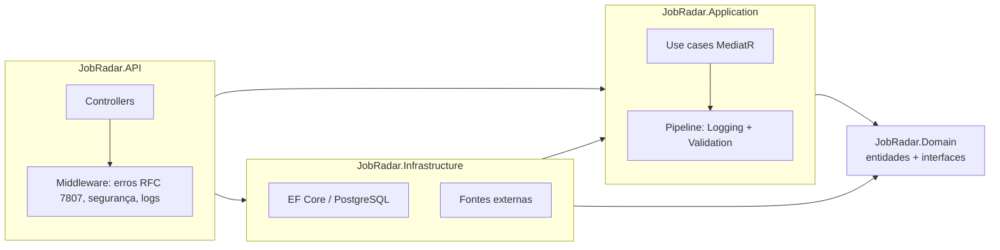

<h1 align="center">JobRadar</h1>

<p align="center">
  Agregador de vagas de tecnologia com autenticação JWT, OAuth com Google e API REST em .NET.
</p>

<p align="center">
  <a href="https://github.com/evertonldesouza/JobRadar/actions/workflows/ci.yml"></a>
  <a href="https://github.com/evertonldesouza/JobRadar/actions/workflows/codeql.yml"></a>
  
  
  <a href="LICENSE"></a>
</p>

<p align="center">
  <a href="https://jobradar-rzbd.onrender.com" target="_blank">Ver Demo</a> ·
  <a href="docs/">Frontend</a> ·
  <a href="https://github.com/evertonldesouza/JobRadar/issues">Reportar Bug</a> ·
  <a href="CONTRIBUTING.md">Contribuir</a>
</p>

> [!IMPORTANT]
> A demo está hospedada no **Render (free tier)**. O servidor hiberna quando inativo — a **primeira carga pode levar de 20 a 40 segundos**.

---

## Sobre

O JobRadar agrega vagas de tecnologia de múltiplas fontes públicas, permite filtrar por tecnologia, localização e fonte, salvar favoritos, criar alertas e recebe atualizações automáticas via background service.

## Funcionalidades

- 🔐 Autenticação com **JWT** (expiração configurável) e **OAuth via Google**, com vínculo de contas existentes
- 🔎 Listagem e filtragem de vagas por tecnologia, localização e fonte, com paginação validada (máx. 100/página) e **busca tolerante** (ignora caixa e também procura no título/empresa), com o termo **destacado** nos cards
- 🗂️ **Página de detalhes** por vaga (`docs/job.html?id=…`) com meta tags dinâmicas para compartilhamento
- ⭐ **Favoritos** que funcionam até sem conta (guardados no navegador) e são **sincronizados automaticamente** ao entrar (`POST /api/favorites/merge`)
- 🔔 **Alertas de vagas** — novas vagas compatíveis disparam notificação (hoje via `MockEmailService`)
- 🛰️ **5 fontes agregadas** (RemoteOK, Remotive, CareerNest, JobsBase, Adzuna), buscadas em paralelo, com deduplicação em lote
- 🔄 Sincronização manual autenticada (`POST /api/jobs/sync`) e **automática configurável** via background service
- ⚡ Cache em memória com invalidação após cada sync
- 🚦 **Rate limiting** por IP (geral + política estrita para login/registro)
- 📤 **Export CSV** protegido contra CSV injection
- 🩺 Health checks separados: `/health/live` (processo) e `/health/ready` (banco), além de `/healthz` (compatibilidade)
- 🛡️ Erros em **RFC 7807 ProblemDetails**, cabeçalhos de segurança, CORS por configuração e correlation id por requisição
- ✅ Validação com FluentValidation no pipeline MediatR, logs de duração por request e testes com xUnit + Moq

## Stack

| Camada | Tecnologia |
|---|---|
| Backend | C# / .NET 10, ASP.NET Core, MediatR (CQRS), FluentValidation |
| Banco | PostgreSQL 16 + EF Core |
| Autenticação | JWT Bearer + Google OAuth |
| Frontend | HTML/CSS/JavaScript vanilla (em `docs/`, publicado no GitHub Pages) |
| Infra | Docker, docker-compose |
| Deploy | Render (API) + GitHub Pages (Frontend) |
| CI/CD | GitHub Actions (build, testes, cobertura, Docker, CodeQL, Dependabot) |

## Arquitetura

Clean Architecture em quatro projetos — dependências apontam sempre para dentro:



| Projeto | Responsabilidade |
|---|---|
| `JobRadar.Domain` | Entidades com invariantes (`Job`, `User`, `JobAlert`, `FavoriteJob`) e interfaces de repositório/fonte |
| `JobRadar.Application` | Use cases (CQRS com MediatR), DTOs, validadores e behaviors de pipeline; registro em `AddApplication()` |
| `JobRadar.Infrastructure` | EF Core, repositórios, fontes de vagas, JWT e email; registro em `AddInfrastructure()` |
| `JobRadar.API` | Controllers finos, autenticação, health checks e pipeline HTTP |

## Rodando localmente

**Pré-requisitos:** Docker. Para rodar fora do Docker: .NET 10 SDK (veja `global.json`).

### Opção 1 — tudo com Docker (recomendado)

```bash
git clone https://github.com/evertonldesouza/JobRadar.git
cd JobRadar
cp .env.example .env   # ajuste JWT_SECRET e as senhas
docker compose up --build
```

- API: `http://localhost:8080` · Health: `http://localhost:8080/health/ready`
- Frontend: sirva a pasta `docs/` (ex.: `npx serve docs`) ou abra pelo GitHub Pages.

### Opção 2 — API local + banco no Docker

```bash
docker compose up -d postgres
dotnet run --project src/JobRadar.API
```

A API estará em `http://localhost:5225` e a documentação interativa (Scalar) em `/scalar/v1` no ambiente de desenvolvimento.

## Configuração

Copie `.env.example` para `.env` (Docker) ou use variáveis de ambiente/User Secrets. **Nunca commite segredos** — a API se recusa a subir sem um `Jwt:Secret` de 32+ caracteres.

| Variável | Descrição | Obrigatória |
|---|---|---|
| `ConnectionStrings__DefaultConnection` | String de conexão PostgreSQL | ✅ |
| `Jwt__Secret` | Chave de assinatura JWT (mín. 32 caracteres) | ✅ |
| `Jwt__ExpirationHours` | Validade do token (padrão: 24) | |
| `Cors__AllowedOrigins__0...` | Origens permitidas em produção (em dev, qualquer origem) | |
| `Authentication__Google__ClientId/Secret` | OAuth Google (sem isso, o botão Google fica inativo) | |
| `Adzuna__AppId` / `Adzuna__AppKey` | Fonte Adzuna (as demais fontes não precisam de chave) | |
| `Sync__IntervalHours` / `Sync__InitialDelayMinutes` | Periodicidade do sync automático (padrão: 1h / 1min) | |
| `Frontend__BaseUrl` | URL do site (redirect pós-Google e link de recuperação) | |
| `Smtp__Host/Port/User/Password/From` | Envio real de email; sem `Host`, usa o mock de dev | |

## API (principais endpoints)

| Método | Endpoint | Auth | Descrição |
|---|---|---|---|
| `GET` | `/api/jobs?technology=&location=&source=&page=&pageSize=` | — | Lista vagas (pageSize ≤ 100) |
| `GET` | `/api/jobs/{id}` | — | Detalhe de uma vaga (404 com ProblemDetails se não existir) |
| `GET` | `/api/jobs/sources` | — | Fontes ativas (descobertas via DI) |
| `GET` | `/api/jobs/export` | — | Exporta CSV (até 5.000 vagas) |
| `POST` | `/api/jobs/sync` | ✅ JWT | Importa novas vagas |
| `DELETE` | `/api/jobs/duplicates` | ✅ JWT | Remove duplicatas |
| `POST` | `/api/auth/register` · `/api/auth/login` | — | Conta com email/senha (senha: 8+, letras e números) |
| `POST` | `/api/auth/refresh` | — | Renova o access token (refresh rotativo, com detecção de reuso) |
| `POST` | `/api/auth/logout` | ✅ JWT | Revoga o refresh token da sessão |
| `GET` | `/api/auth/me` | ✅ JWT | Perfil do usuário logado |
| `POST` | `/api/auth/forgot-password` · `/api/auth/reset-password` | — | Recuperação de senha por email (link de 1h) |
| `GET` | `/api/auth/google` | — | OAuth Google (callback redireciona ao frontend com os tokens) |
| `GET/POST/DELETE` | `/api/favorites[/{jobId}]` | ✅ JWT | Favoritos do usuário |
| `POST` | `/api/favorites/merge` | ✅ JWT | Sincroniza favoritos salvos no navegador (idempotente, até 200 ids) |
| `GET/POST/DELETE` | `/api/alerts[/{id}]` | ✅ JWT | Alertas do usuário |

Erros seguem o formato **ProblemDetails** (`title`, `detail`, `status`, `traceId`; validações incluem `errors` por campo). Exemplos prontos em [`src/JobRadar.API/JobRadar.API.http`](src/JobRadar.API/JobRadar.API.http).

### Fontes de vagas

| Fonte | Endpoint | Chave |
|---|---|---|
| [RemoteOK](https://remoteok.com) | `GET /remote-jobs.json` | ❌ |
| [Remotive](https://remotive.com) | `GET /api/remote-jobs` | ❌ |
| [CareerNest](https://careernest.cloud) | `GET /api/feed?limit=50` | ❌ |
| [JobsBase](https://jobsbase.io) | `GET /api/v1/jobs?limit=50` | ❌ |
| [Adzuna](https://adzuna.com) | `GET /api/jobs/gb/search/1` | ✅ |

Para adicionar uma fonte, implemente `IJobSource` em `src/JobRadar.Infrastructure/Sources/` e registre-a em `Infrastructure/DependencyInjection.cs` — o sync a descobre automaticamente via DI.

> [!NOTE]
> O workflow agendado de sync (`.github/workflows/sync-jobs.yml`) agora exige o secret **`JOBRADAR_TOKEN`** (JWT de um usuário), pois o sync deixou de ser público. O sync automático embutido na API continua funcionando sem token.

## Testes

```bash
dotnet test            # xUnit + Moq: handlers, domínio e validadores, com cobertura (coverlet)
node --check docs/script.js
node --check docs/job.js
```

## Segurança

Endpoints de escrita administrativa exigem JWT, senhas usam BCrypt, tokens têm `jti` e expiração curta configurável, e a API aplica rate limiting, cabeçalhos de segurança e CORS restritivo por ambiente. Para reportar uma vulnerabilidade, veja [SECURITY.md](SECURITY.md).

## Contribuindo

Veja [CONTRIBUTING.md](CONTRIBUTING.md). Histórico de mudanças em [CHANGELOG.md](CHANGELOG.md).

## Licença

[MIT](LICENSE)

## Autor

**Everton L. de Souza** — [LinkedIn](https://linkedin.com/in/evertonldesouza) · [GitHub](https://github.com/evertonldesouza)
